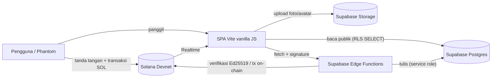

# DonasiWeb3 — Crowdfunding Transparan di Solana

**Demo portofolio** aplikasi penggalangan dana (crowdfunding) berbasis Solana.
Donasi dikirim **langsung dompet-ke-dompet** (non-custodial) dan setiap transaksi
bisa diverifikasi siapa saja lewat Solana Explorer — arus kasnya transparan.

> ⚠️ **Demo di Solana Devnet. Tidak memakai uang asli.**
> Belum diaudit dan tidak disarankan untuk mainnet pada kondisi saat ini.

---

## Ringkasan

Platform di mana siapa pun bisa membuat campaign penggalangan dana, dan donatur
mengirim SOL langsung ke dompet pembuat campaign. Login tanpa password: cukup
tanda tangan pesan dengan wallet (Phantom). Sumber kebenaran data adalah
blockchain — tabel di database hanya cache UI yang sudah diverifikasi server.

- **Non-custodial:** dana tidak pernah singgah ke server aplikasi.
- **Login tanpa password:** bukti kepemilikan wallet via tanda tangan Ed25519.
- **Donasi terverifikasi on-chain:** server memeriksa transaksi Solana sebelum mencatatnya.
- **Transparan & "tutup bukan hapus":** riwayat donasi tidak bisa dihapus.

## Demo Langsung

🔗 **[https://crowdfunding-web3-xaho.vercel.app/#/login](https://crowdfunding-web3-xaho.vercel.app/#/login)**

> Demo di Solana Devnet. Login memakai ekstensi Phantom (set ke Devnet).

## Fitur

- **Login wallet** (Phantom) dengan verifikasi tanda tangan — tanpa password.
- **Buat campaign**: judul, deskripsi, target, plus bukti foto & titik lokasi (opsional).
- **Donasi SOL on-chain** dengan verifikasi transaksi di server sebelum dicatat.
- **Buku kas global** (`#/transparency`): semua donasi, urut terbaru, tertaut ke Explorer.
- **Profil pengguna**: nama, bio, avatar, campaign saya, riwayat donasi (paginasi).
- **Pelaporan & moderasi**: laporan campaign (1 per wallet per campaign), panel
  moderator untuk meninjau/menutup (whitelist wallet + tanda tangan).
- **Live feed** donasi baru (Supabase Realtime).
- Banner pengingat mode **Devnet** yang selalu tampil.

## Arsitektur



**Edge Functions** (semua di-deploy `--no-verify-jwt`, tetapi setiap operasi
tulis memverifikasi tanda tangan wallet atau membaca on-chain):

| Fungsi | Tugas |
| --- | --- |
| `create-campaign` | Verifikasi kepemilikan wallet lalu insert campaign |
| `verify-donation` | Verifikasi transaksi Solana on-chain lalu catat donasi |
| `update-profile` | Simpan profil (UPDATE `users`) setelah verifikasi tanda tangan |
| `set-campaign-status` | Tutup/tinjau campaign (creator + moderator) |
| `report-campaign` | Kirim laporan campaign (wajib tanda tangan pelapor) |
| `check-admin` | Boolean "apakah wallet ini moderator?" (khusus UI) |
| `list-campaign-reports` | Baca daftar laporan (khusus moderator, wajib tanda tangan) |

## Tech Stack

- **Frontend:** Vanilla JavaScript + Vite, router hash SPA (tanpa framework).
- **Blockchain:** `@solana/web3.js`, Phantom Wallet, Solana **Devnet**.
- **Backend:** Supabase (Postgres + RLS, Storage, Realtime, Edge Functions/Deno),
  `@supabase/supabase-js`, `@noble/curves` (Ed25519) di Edge Function.
- **Testing:** Vitest (unit) + skrip Playwright (e2e/smoke).

## Menjalankan Lokal

1. **Install dependency**
   ```bash
   npm install
   ```
2. **Supabase** — buat project, lalu jalankan **berurutan** di SQL Editor:
   1. `database/schema.sql`
   2. `database/migrations/20250105000000_admin_and_campaign_reports.sql`
   3. `database/migrations/20250106000000_revoke_public_update_users.sql`
   4. `database/migrations/20250107000000_storage_insert_policies.sql`

   Urutannya penting: `schema.sql` belum mengenal `admin_wallets`,
   `campaign_reports`, status `flagged`, atau bucket storage.
   Buat 2 bucket Storage (Supabase → Storage → New bucket), keduanya **Public**:
   `avatars` dan `campaign-photos`.
3. **Environment** — salin `.env.example` → `.env`:
   ```
   VITE_SUPABASE_URL=https://xxxx.supabase.co
   VITE_SUPABASE_ANON_KEY=ey...
   VITE_SOLANA_NETWORK=devnet   # opsional, default devnet
   ```
   Hanya **anon key** yang dipakai di browser. Service role key **tidak pernah**
   masuk frontend.
4. **Deploy Edge Functions** (lihat bagian [Konfigurasi Deploy](#konfigurasi-deploy)).
5. **Daftarkan wallet moderator** (manual, setelah migration sukses):
   ```sql
   insert into public.admin_wallets (wallet_address)
   values ('<WALLET_ADMIN_ANDA>')
   on conflict (wallet_address) do nothing;
   ```
6. **Jalankan**
   ```bash
   npm run dev        # http://localhost:5173
   ```
   Pasang ekstensi [Phantom](https://phantom.app/), set ke **Devnet**, ambil SOL
   gratis dari [faucet](https://faucet.solana.com/).

## Konfigurasi Deploy

Build menghasilkan folder `dist/` statis (path asset relatif lewat `base: './'`
di `vite.config.js`), jadi bisa ditaruh di Vercel / Netlify / Cloudflare Pages
**tanpa rewrite server** — router memakai hash (`#/dashboard`).

Environment variable di hosting:

| Nama | Nilai |
| --- | --- |
| `VITE_SUPABASE_URL` | URL project Supabase |
| `VITE_SUPABASE_ANON_KEY` | anon (public) key |
| `VITE_SOLANA_NETWORK` | `devnet` (opsional) |

### 🔧 LANGKAH SAYA (hal yang hanya bisa kamu lakukan)

Isi nilai nyata & jalankan sendiri; jangan kirim secret ke siapa pun:

1. Set secret Supabase (batasi CORS ke domain hosting kamu — bukan `*`):
   ```bash
   npx supabase login
   npx supabase link --project-ref <ref-project>
   npx supabase secrets set SOLANA_NETWORK=devnet
   npx supabase secrets set ALLOWED_ORIGINS=https://<domain-hosting-kamu>
   # bisa lebih dari satu, dipisah koma; tambahkan http://localhost:5173 untuk dev
   ```
   `ALLOWED_ORIGINS` kosong hanya mengizinkan `http://localhost:5173`.
   `SOLANA_NETWORK` **harus** sama dengan `VITE_SOLANA_NETWORK` (default `devnet`).
2. Set env yang sama di dashboard hosting (Vercel → Settings → Environment Variables).
3. Setelah env hosting berubah, **redeploy** agar nilai baru ter-bundle.

## Keputusan Teknis & Keamanan

Bagian ini jujur menyebut apa yang sudah dan **belum** dilakukan.

- **Non-custodial.** Donasi dikirim `SystemProgram.transfer` langsung dari wallet
  donatur ke wallet campaign; server tidak pernah memegang dana pengguna.
- **Login tanda tangan wallet.** Tidak ada password/sesi server. Kepemilikan
  wallet dibuktikan tanda tangan Ed25519 yang diverifikasi server.
- **Verifikasi donasi on-chain.** Insert ke `donations` **tidak** bisa dari klien;
  hanya lewat `verify-donation` yang memeriksa transaksi di jaringan Solana
  (penandatangan, penerima, jumlah tepat) lalu menulis dengan service role.
  `tx_signature` `UNIQUE` mencegah replay.
- **"Tutup bukan hapus".** Tidak ada jalur DELETE dari aplikasi. Campaign yang
  ditutup/ditandai tetap publik beserta seluruh riwayat donasinya. Menghapus data
  hanya bisa manual dari dashboard Supabase.
- **Moderasi whitelist wallet.** Hanya wallet di `admin_wallets` yang bisa
  moderasi — dan tetap wajib tanda tangan. `admin_wallets` tidak bisa dibaca publik.
- **RLS ketat.** `donations`/`campaigns` tanpa policy insert publik;
  `campaign_reports` tanpa SELECT/INSERT publik; UPDATE `users` dicabut (lewat
  Edge Function).
- **XSS minimal.** Semua nilai dari pengguna/DB di-escape; URL gambar
  (`avatar_url`, `photo_urls`) hanya diterima bila **https** dan host-nya persis
  project Supabase ini — divalidasi di klien **dan** server.
- **Secret bersih.** Hanya anon key (memang publik) yang ada di bundle; service
  role key hanya di Edge Function. `.env` di-`.gitignore` dan tidak pernah ter-commit.
- **CORS whitelist.** Edge Function menolak origin di luar `ALLOWED_ORIGINS` (403).

### Batasan yang diketahui

- **Hanya Devnet.** Tidak ada nilai uang nyata dan **belum diaudit untuk mainnet**.
- **Belum ada rate limiting** per-IP/per-wallet di Edge Function maupun REST.
- **Policy Storage** hanya bisa memvalidasi *bentuk path*, bukan identitas, karena
  klien tidak punya JWT (`auth.uid()` selalu null). Penimpaan file & pembanjiran
  bucket dicegah, tetapi path berawalan wallet orang lain secara teknis masih bisa.
- Dana harus masuk ke wallet yang sama dengan pembuat campaign
  (`campaign_wallet === creator_wallet`); belum ada dukungan multi-wallet/organisasi.
- Hanya mendukung Phantom.

## Rencana jika ke Mainnet

1. **Rate limiting** + batas ukuran body di setiap Edge Function / API gateway.
2. **Audit keamanan** pihak ketiga & **uji beban**.
3. Ubah `VITE_SOLANA_NETWORK` **dan** secret `SOLANA_NETWORK` ke `mainnet-beta`
   secara bersamaan; pakai **RPC berbayar** (bukan RPC publik) dengan API key
   disimpan sebagai secret server.
4. Set `ALLOWED_ORIGINS` ke domain produksi; aktifkan security headers (CSP, HSTS).
5. Batas awal yang kecil (mis. target & donasi maksimum) + **monitoring** dan
   **rencana rollback**.
6. Pertimbangkan **escrow via smart contract (Anchor)** bila butuh pencairan
   bertahap / multi-pihak.

## Testing

```bash
npm run lint      # ESLint
npm test          # Vitest (unit)
npm run build     # build produksi → dist/
npm run preview   # jalankan hasil build secara lokal
```

Skrip e2e/smoke (butuh dev server `http://localhost:5173`):

```bash
node tests/e2e/cors-smoke.mjs        # CORS: preflight 204 + ACAO, origin asing ditolak
node tests/e2e/repro-bug1.mjs        # submit campaign → respons server nyata
node tests/e2e/repro-bug2.mjs        # aksi per status + tab filter panel admin
```

## Struktur Proyek

```
index.html
vite.config.js             # base './' agar jalan di hosting statis
src/
  main.js                  # entry point + daftar rute + banner devnet
  router.js                # router SPA berbasis hash
  wallet.js                # koneksi Phantom, kirim SOL, NETWORK (dari env)
  supabaseClient.js        # klien Supabase + pemanggil Edge Function
  utils.js                 # escapeHtml, safeStorageUrl, status, dll.
  adminAccess.js           # cek hak moderator (UI, bukan otorisasi)
  adminActions.js          # mesin status → aksi moderasi (murni, teruji)
  components/              # nav, ui, particles, devnetBanner
  pages/                   # login, dashboard, createCampaign, campaignDetail,
                           #   transparency, profile, admin
database/
  schema.sql               # skema + RLS
  migrations/              # migration AFTER schema.sql (urutan WAJIB)
supabase/functions/        # 7 Edge Function + _shared/cors.ts
tests/                     # unit (vitest) + e2e/ (playwright)
```

---

Dibuat untuk pembelajaran & portofolio. Kontribusi/saran diterima.
